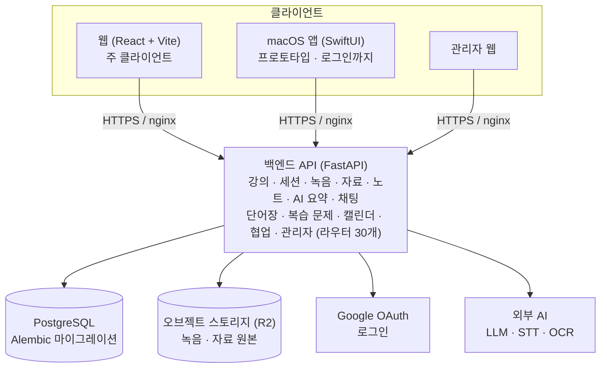
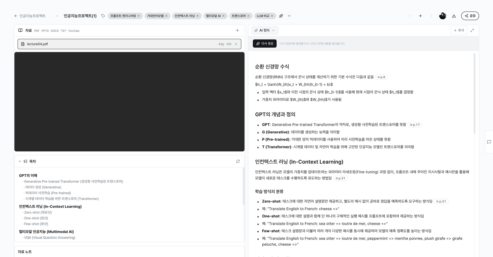

# Tone

> 자료와 음성을 나만의 지식 도구로 바꾸는 AI 작업공간

Tone은 강의·회의에서 **듣는 것(녹음)**, **보는 것(PDF·발표자료)**, **생각한 것(노트)** 을 한 공간에 모으고 AI로 정리·질문·복습까지 이어지게 만드는 웹 서비스입니다.

## 목차

- [만든 이유](#만든-이유)
- [핵심 흐름](#핵심-흐름)
- [주요 기능](#주요-기능)
- [시스템 구조](#시스템-구조)
- [AI 활용 방안](#ai-활용-방안)
- [UI/UX](#uiux)
- [기술 스택](#기술-스택)
- [개발 일정](#개발-일정)
- [제품 원칙](#제품-원칙)

## 만든 이유

대부분의 AI 도구는 채팅창에서, 노트 도구는 빈 페이지에서 시작합니다. 녹음 도구는 STT 결과에서 멈춥니다.

하지만 실제 공부와 업무는 그 사이에서 일어납니다. 누군가의 말을 들으면서 자료를 넘겨 보고 이해한 내용을 노트에 적은 뒤, 나중에 다시 꺼내 쓸 수 있게 정리합니다. 지금은 녹음 앱, PDF 뷰어, 노트 앱, ChatGPT를 오가며 이 일을 직접 이어 붙여야 합니다.

Tone은 이 흐름을 한 화면에서 끊기지 않게 잇는 것을 목표로 합니다.

## 핵심 흐름

```text
자료 업로드 → 녹음 / STT → 노트 작성 → AI 정리·대화 → 복습
```

1. 강의(또는 프로젝트) 공간을 만들고 PDF·PPTX·DOCX 자료를 올립니다.
2. 수업이나 회의를 녹음해 올리면 음성이 텍스트(STT)로 바뀝니다.
3. 자료와 STT를 나란히 보면서 노트를 씁니다.
4. AI가 자료와 STT를 바탕으로 요약을 만들고 요약의 각 항목에는 원본 위치(`[분:초]`, `[page:N]`)가 붙습니다.
5. 모르는 부분은 그 강의 자료를 근거로 AI에게 묻고 복습 문제로 이해했는지 확인합니다.

## 주요 기능

| 영역 | 설명 |
| --- | --- |
| 공간 관리 | 강의·프로젝트 단위로 주차·세션을 나눠 자료와 녹음을 관리 |
| 자료 | PDF·PPTX·DOCX 업로드, 텍스트 자동 추출 (스캔 PDF는 OCR) |
| 녹음 / STT | 녹음 파일 업로드, 전사 진행 상태 추적, 스크립트 열람 |
| 노트 | 자료와 STT를 보며 작성하는 블록 기반 에디터 |
| AI 요약 | 자료 + 스크립트를 바탕으로 구조화된 요약 생성, 항목별 출처 표시 |
| AI 대화 | 특정 강의의 자료를 맥락으로 한 질의응답 |
| 용어 설명 | 선택한 단어를 현재 맥락에 맞게 설명하고 단어장에 저장 |
| 복습 문제 | 노트·요약을 바탕으로 확인 문제를 만들고 능동 회상 카드로 풀기 |
| 캘린더 | 수업 일정과 세션을 달력으로 확인 |
| 공유·협업 | 초대 링크, 공유 링크 |
| 관리자 | 사용자·사용량 관리, 시스템 상태 점검 |

## 시스템 구조



- **데이터 원칙**: 원본 자료와 사용자가 쓴 노트가 진실의 원본이고 AI 결과물은 그 위에서 만들어지는 파생물입니다.
- **무거운 작업은 백그라운드로**: 자료 텍스트 추출, OCR, STT, 요약 생성은 업로드 요청과 분리해 백그라운드에서 처리하고 화면은 진행 상태를 보여 줍니다.
- **배포**: GitHub Actions에서 단위 테스트와 e2e 테스트(Playwright)를 통과한 커밋만 서버에 배포합니다. 서버는 Docker Compose로 운영하고 DB 마이그레이션은 배포 스크립트가 적용합니다.

## AI 활용 방안

| 용도 | 사용 모델 / 서비스 | 내용 |
| --- | --- | --- |
| 음성 → 텍스트 | OpenAI Whisper | 한국어로 고정해 전사 정확도 확보 |
| 스캔 문서 OCR | 네이버 CLOVA OCR → Gemini | 텍스트 레이어가 없는 PDF 페이지를 이미지로 읽어 글자 추출. CLOVA 실패 시 Gemini 멀티모달로 대체 |
| 요약 생성 | Claude (Sonnet) → Gemini | 강의·회의·아이디어 구간을 자동으로 구분해 구조화된 요약 생성. Claude 실패 시 Gemini로 대체 |
| 출처 검증 | 자체 로직 | 요약 항목마다 녹음 `[분:초]`, 자료 `[page:N]`·`[slide:N]` 출처를 붙이고, 원본에 실제로 있는 위치만 남김 |
| AI 대화 | LLM + 자료 근거 | 질문과 관련된 자료·녹음·노트 조각을 근거로 답하고, 답에 쓴 조각을 인용으로 표시. 제공하지 않은 출처를 인용하면 걸러냄 |
| 용어 설명 · 복습 문제 | LLM | 현재 강의 맥락에 맞춘 설명, 노트 기반 확인 문제 생성 |

AI를 쓰면서 지키는 원칙입니다.

- **근거 없는 답을 줄인다**: 요약과 대화 모두 사용자가 올린 자료와 녹음을 근거로 삼고 어디에서 나온 내용인지 확인할 수 있게 합니다.
- **한 모델이 실패해도 멈추지 않는다**: 요약과 OCR은 1차 모델이 실패하면 다른 모델로 넘어갑니다. OCR이 실패해도 업로드는 깨지지 않습니다.
- **비용을 통제한다**: 사용자별 일일 사용 상한을 두고 사용량을 집계해 관리자 화면에서 확인합니다.

## UI/UX

<!-- 스크린샷을 docs/images/ 에 넣고 아래 경로를 맞춰 주세요 -->

| 화면 | 설명 |
| --- | --- |
| 대시보드 | 내 강의·프로젝트 목록 |
| 강의 상세 | 주차별 세션과 자료 |
| 세션 작업공간 | 왼쪽에 자료·스크립트, 오른쪽에 노트. 패널 크기 조절 가능 |
| AI 요약 | 구조화된 요약과 항목별 `[분:초]` 출처 |
| AI 대화 | 강의 자료를 근거로 한 질의응답 |
| 복습 | 능동 회상 카드 |

<!--




-->

## 기술 스택

| 구분 | 기술 |
| --- | --- |
| Frontend | React, Vite, React Router, Zustand, BlockNote, React Resizable Panels |
| Backend | Python, FastAPI, SQLAlchemy, Alembic |
| Database / Storage | PostgreSQL 16, Cloudflare R2 호환 오브젝트 스토리지 |
| 인증 | Google OAuth (웹 + 데스크탑 deep link) |
| AI | Claude, Gemini, OpenAI Whisper, CLOVA OCR |
| Desktop | SwiftUI (macOS, 프로토타입) |
| 테스트 | pytest, Playwright (e2e) |
| 배포 | GitHub Actions, Docker Compose, nginx |

## 개발 일정

### 지금까지

| 시기 | 단계 | 내용 |
| --- | --- | --- |
| 2026-04 ~ 05 | v0.5 | 로그인, 녹음, 강의 모델, 자동 노트, 블록 에디터. 직접 사용하며 검증 (5/5 ~ 5/12) |
| 2026-05 ~ 07 | v3.1 | 서버 중심으로 재구성. 백엔드 9개 라우터 복구, 웹 화면 재연결, e2e 테스트 8종 통과, macOS 앱 로그인 |
| 2026-07 | v0.9 | 강의·회의·아이디어 용도 확장, 요약 출처 검증, 약관·개인정보 처리방침, 사용 이벤트 측정 |
| 2026-07 ~ 09 | — | OCR 추가, 운영 서버 배포와 CI/CD 구축 |
| 2026-09-30 | Phase C | 경진대회 출품을 위해 개발 재개 |

### 앞으로 (Phase C)

| 단계 | 내용 | 상태 |
| --- | --- | --- |
| C1 | 개발 재개 결정 기록 | 완료 |
| C2 | 사용량 집계 오류 수정·배포 | 완료 |
| C3 | 사용량 정책 개편 (코인 → 일일 할당제) | 진행 중 |
| C4 | 대회 요강 확인 후 출품 범위 확정 (웹 / macOS 앱 포함 여부) | 예정 |
| C5 | 처음 쓰는 사람 기준 점검 (가입부터 첫 세션까지), 알려진 제약 정리 | 예정 |
| C6 | 심사·시연 준비 (심사용 계정, 시연 영상) | 예정 |
| C7 | 운영 비용 점검 (LLM·OCR·스토리지·서버) | 예정 |

### 이후 로드맵

- 강의 중심 구조를 회의·리서치·발표 준비·프로젝트 공간으로 일반화
- STT 재생 위치와 스크립트 하이라이트 연동
- 마인드맵·구조도 자동 생성
- 내 노트 맥락에 맞춘 논문·웹 검색
- 내보내기와 Obsidian 연동

## 제품 원칙

1. **캡처가 먼저다** — 녹음은 나중에 붙이는 첨부 파일이 아니라 작업이 시작되는 지점입니다.
2. **자료는 항상 근거로 남는다** — 문서·녹음·노트·AI 결과가 서로 연결되고 AI 결과는 원본으로 되돌아갈 수 있어야 합니다.
3. **지식은 사용자가 소유한다** — 노트와 구조는 사람이 읽고 옮기고 오래 보관할 수 있어야 합니다.
4. **기능이 아니라 도구다** — 요약·질문·용어 정리·AI 대화는 사용자가 자기 공간에 붙여 쓰는 도구입니다.
